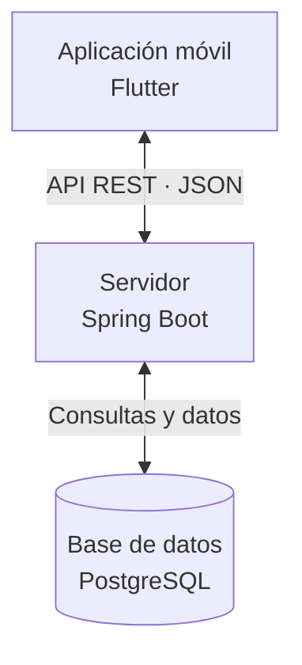

# Arquitectura del sistema

## Visión general

EcoRide utiliza una arquitectura formada por tres componentes principales: una aplicación móvil, un servidor y una base de datos.

Estos componentes trabajan juntos para permitir a los usuarios consultar estaciones, reservar bicicletas y revisar sus trayectos.

## Diagrama de arquitectura

El siguiente diagrama muestra cómo se comunican los tres componentes:

## Aplicación móvil: Flutter

Flutter se utiliza para desarrollar la aplicación móvil de EcoRide. Permite a los usuarios consultar las estaciones, ver las bicicletas disponibles, realizar reservas y revisar su historial de trayectos.

## Servidor: Spring Boot

Spring Boot se encarga de gestionar las peticiones que recibe desde la aplicación móvil. Procesa la información, aplica la lógica del sistema y se comunica con la base de datos. La comunicación se realiza mediante una API REST utilizando JSON.

## Base de datos: PostgreSQL

PostgreSQL almacena toda la información de EcoRide, como los usuarios, las estaciones, las bicicletas y las reservas. Permite guardar y consultar los datos cuando sea necesario.

## Flujo de una petición

Cuando un usuario realiza una acción desde la aplicación móvil, por ejemplo, consultar las bicicletas disponibles, Flutter envía una petición al servidor Spring Boot mediante la API REST. El servidor recibe la petición, consulta la información necesaria en PostgreSQL y obtiene los resultados. Finalmente, Spring Boot devuelve los datos en formato JSON a la aplicación móvil, donde se muestran al usuario.
